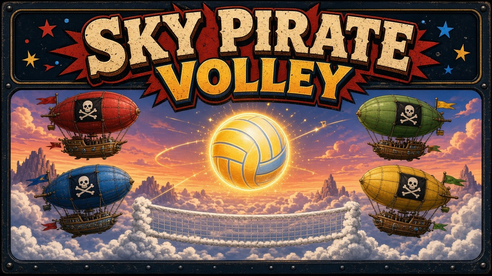

# Sky Pirate Volley

Four airships, one glowing cannonball, and a net made of cloud. Port (P1 and P2) faces starboard (P3 and P4) in a side-view rally, or all four ships scatter into their own quadrants and fight to be the last one flying. It is a local game for one shared screen: keyboard or gamepad, with bots ready to fill any empty seat.

## Launch

The game is plain HTML, CSS, and JavaScript. A tiny Python 3 server hosts it on `127.0.0.1` at port **8820** (or the next free port) and opens your browser. No install step and no network after the files are on disk.

| System | One-click |
| --- | --- |
| macOS | Double-click `launch-mac.command` |
| Windows | Double-click `launch-windows.bat` |
| Linux | `./launch-linux.sh` |

From a terminal, `python3 server.py` does the same thing. If Python 3 is missing, the launcher says so instead of failing silently.

## Controls

Keyboard works with no gamepads plugged in. A connected gamepad in slot 0–3 takes over that player's keys until it is unplugged. Start pauses. M mutes. Bindings can be rewritten on the Controls screen and are stored in `localStorage`.

| Player | Move | Cannon (action) | Boost / spike (secondary) |
| --- | --- | --- | --- |
| P1 | W A S D | F | G |
| P2 | Arrow keys | `/` | `.` |
| P3 | I J K L | `;` | `'` |
| P4 | Numpad 8 4 5 6 | Numpad 0 | Numpad Enter |
| Gamepad | Left stick or D-pad | A | B |

Hold the cannon to charge a power shot, then release while the ball is in range. The stick (or keys) you are holding aims the shot. Below the net, secondary is a boost dodge. Above the net, secondary is a spike.

On the title screen, press Enter or Start. On the join screen, each player presses their cannon key to climb aboard. Secondary toggles an empty seat between bot and sitting out. Enter launches. Open seats become bots, so one person can play against the crew.

## Rules

The court is split by a cloud net. Ships move freely inside their own half (2v2) or their own quadrant (free-for-all), but they cannot cross the boundary.

**2v2.** P1 and P2 are port, P3 and P4 are starboard. A side may cannon the ball three times. A fourth touch is a fault. The ball has to be batted — flying into the cloud net is a fault for whoever hit it last (or for the server, if it is still the serve). When the ball falls through a side's bottom clouds, the other side scores. Wind changes every rally.

**Free-for-all.** Each ship owns a quadrant. Letting the ball fall through the bottom of your quadrant costs a life. The top quadrants' floor is the midline; the bottom quadrants' floor is the cloud deck. An empty quadrant faults the last ship that touched the ball.

Pickups drift in on some rallies: a tailwind (harder next shot), a storm keg (a heavier blast), an extra touch for your side, or a lifeboat (one life back in the free-for-all, or a cleared touch count in 2v2).

## Scoring

2v2 is rally scoring to **11**, win by **2**, best of **3** games (change the round count in Settings to best of 1, 3, or 5). The HUD shows the team rally score, each ship's credited points, the game number, the touch count, and the wind.

Free-for-all gives every ship **7** lives. A life is lost when the ball lands in that ship's zone. At zero lives the ship is out. The last ship flying wins. The match screen lists the standings. Enter rematches; Esc returns to the title.

Pause with Esc or Start. Settings covers volume, round count, and controls.

## arcade.json

`arcade.json` is the Arcade OS manifest: display name, id `skypiratevolley`, icon, cover, per-platform launch commands, a web entry at `index.html`, 4 player slots (minimum 1, because bots can fill the rest), keyboard and gamepad input, port 8820, and version 1.0.0.

## Tests

Core rules live in `src/core/` with no DOM, so they run under Node's built-in test runner:

```bash
node --test tests/
python3 tests/server_smoke.py
```

The JavaScript suite covers movement and court collision, scoring, win-by-two and match length, free-for-all elimination, cannon charge, spikes, boosts, pickups, seeded randomness, keyboard and gamepad mapping, and the arcade manifest. The Python smoke test starts `server.py`, checks that a busy 8820 falls forward to the next port, and fetches the page, the core module, and the manifest. GitHub Actions runs both on every push and pull request.

## License

[MIT](LICENSE).
